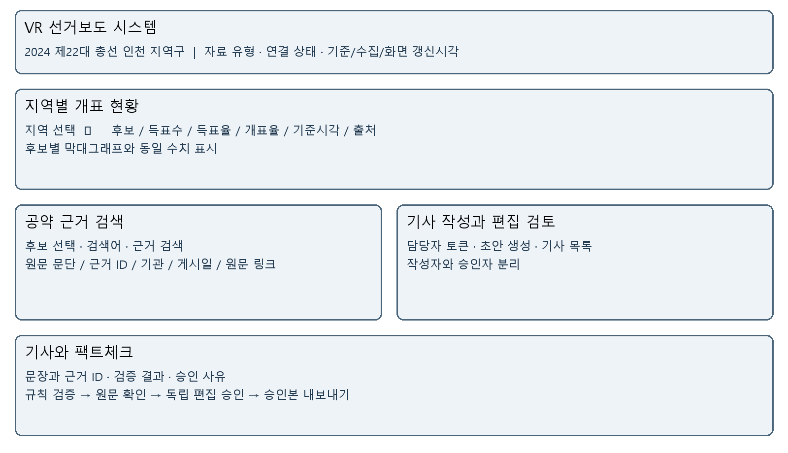
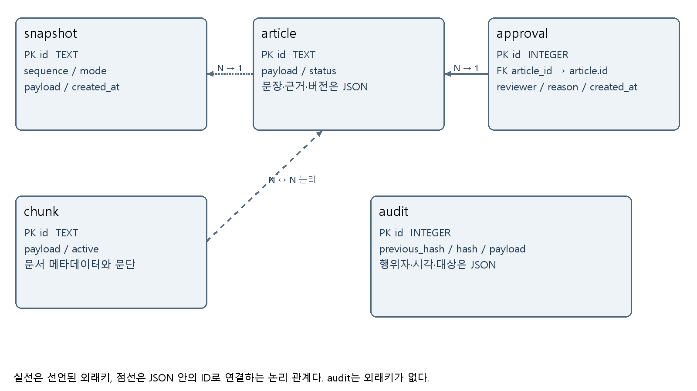
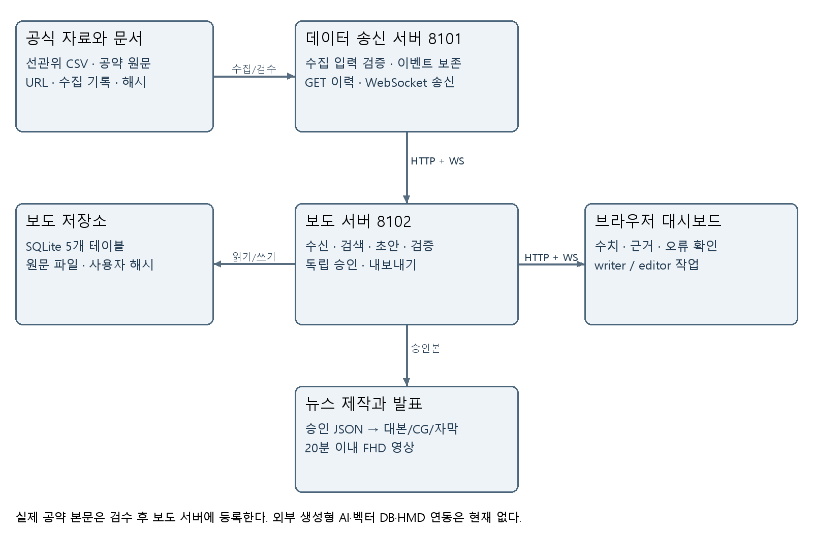

# VR 선거보도 시스템

**표심 다음의 질문, 인천의 공약을 읽다**

2024년 제22대 국회의원선거 인천 지역구를 대상으로 공식 개표 데이터와 공약 근거를 연결하고, 기사 초안 → 팩트체크 → 독립 편집 승인 → 뉴스 제작으로 이어지는 선거보도 시스템입니다.

이 저장소는 프로젝트의 **기획·설계 산출물 7종**을 정리합니다. 실행 소스와 실행 방법은 [Real-time-Election-News](https://github.com/mbc-incheon/Real-time-Election-News)에서 확인할 수 있습니다. 아래 문서는 2026년 11월 23일 로컬 구현과 사용자 확정 범위를 기준으로 작성했습니다.

## 프로젝트 개요

| 구분 | 내용 |
| --- | --- |
| 프로젝트명 | VR 선거보도 시스템 |
| 보도 주제 | 표심 다음의 질문, 인천의 공약을 읽다 |
| 선거 범위 | 2024년 제22대 총선 인천 지역구 14곳 |
| 일정 | **2026년 11월 18일~11월 30일** — 최신 WBS 기준 |
| 핵심 기능 | 공식 자료 수집·원본 보존, WebSocket 갱신, 근거 검색, 문장별 출처 추적, 규칙 검증, 독립 편집 승인 |
| 제작 목표 | 승인 기사와 동일 데이터로 20분 이내 FHD 뉴스 제작 |
| 편집 원칙 | 후보·정당 지지나 공격, 출처 없는 주장, 당락 예측 배제 |

## 산출물 바로가기

문서 링크를 연 뒤 GitHub의 다운로드 기능으로 Word 파일을 받을 수 있습니다. 문서는 모두 수정 가능한 `.docx` 형식입니다.

| 단계 | 산출물 | 포함 내용 | 분량 |
| --- | --- | --- | --- |
| 기획 | [01 기획서](docs/deliverables/01_기획서.docx) | 목적·배경·목표·기능 정의·중립성·**팩트체크 20개 항목** | 7쪽 |
| 기획 | [02 요구사항 정의서](docs/deliverables/02_요구사항_정의서.docx) | 사용자 요구 7개·기능 요구 18개·비기능 요구·인수 시험 | 6쪽 |
| 기획 | [03 WBS](docs/deliverables/03_WBS_역할분담과_일정관리.docx) | 6개 역할·18개 작업·선행 관계·일정표·완료 기준 | 6쪽 |
| 설계 | [04 화면 설계서](docs/deliverables/04_화면_설계서.docx) | UI/UX 화면 구성·메뉴 구조·화면별 동작·오류 처리 | 4쪽 |
| 설계 | [05 ERD 및 데이터베이스 설계서](docs/deliverables/05_ERD_데이터베이스_설계서.docx) | ERD·테이블 5개·컬럼·자료형·키·JSON 참조·무결성 | 4쪽 |
| 설계 | [06 API 명세서](docs/deliverables/06_API_명세서.docx) | 프론트엔드 ↔ 백엔드 요청·응답·권한·오류·WebSocket | 5쪽 |
| 설계 | [07 시스템 아키텍처 설계서](docs/deliverables/07_시스템_아키텍처_설계서.docx) | 전체 서비스 구성도·데이터 흐름·장애 대응·승인 통제 | 4쪽 |

WBS의 56시간은 작업 배분 계획이며 팀원별 실제 투입 시간은 아닙니다. 담당자 실명과 실제 완료 기록은 팀에서 확정합니다.

## 화면 구성과 메뉴

공통 상태 → 지역별 개표 현황 → 공약 근거 검색 → 기사 작성 → 검증과 승인 → 공식 자료실 → 뉴스 제작 안내 순서로 구성합니다. 현재 기본 화면은 하나의 웹 페이지 안에 기능 구역을 배치한 구조입니다.



## 데이터베이스 구조

현재 보도 서버는 SQLite의 `snapshot`, `chunk`, `article`, `approval`, `audit` 테이블을 사용합니다. **실선은 실제 외래키, 점선은 JSON 내부 ID를 이용한 논리 관계**입니다. 정규화 확장안은 문서에서 현재 구조와 구분했습니다.



## 전체 서비스 구성

데이터 송신 서버는 개표 이벤트를 전달하고, 보도 서버는 근거 검색·기사 작성·검증·승인을 담당합니다. 브라우저는 보도 서버에 연결하며, 내보낸 승인본을 대본·CG·자막 제작에 사용합니다.



| 구간 | 통신과 처리 |
| --- | --- |
| 데이터 송신 서버 → 보도 서버 | HTTP 이벤트 이력 조회 + WebSocket 수신, 해시로 중복 방지 |
| 보도 서버 ↔ 브라우저 | HTTP 조회·작성·검증·승인 + WebSocket 화면 갱신 |
| 기사 → 편집 승인 | 규칙 검증 후 작성자와 다른 편집자의 원문 확인과 승인 사유 기록 |
| 승인본 → 뉴스 제작 | 기사 문장·근거 ID·스냅샷 ID를 같은 버전으로 사용 |

## 팩트체크 20개 항목

기획서 5~7쪽에 항목별 확인 기준과 오류·미확인 시 조치를 정리했습니다.

| ID | 확인 항목 | ID | 확인 항목 |
| --- | --- | --- | --- |
| FC01 | 선거 범위 | FC11 | 공약 원문과 주체 |
| FC02 | 지역구 식별 | FC12 | 인용과 공약 맥락 |
| FC03 | 후보와 정당 | FC13 | 정정과 철회 |
| FC04 | 원본 출처 | FC14 | 문장별 근거 연결 |
| FC05 | 집계 범위와 중복 | FC15 | 제목과 보도 표현 |
| FC06 | 득표수와 합계 | FC16 | 규칙과 AI 판정 |
| FC07 | 득표율과 차이 | FC17 | 독립 편집 승인 |
| FC08 | 개표율과 투표율 | FC18 | 승인본과 제작물 |
| FC09 | 기준시각과 시간대 | FC19 | 시각화와 AI 표시 |
| FC10 | 실제 자료와 재현 | FC20 | 감사와 최종 재검증 |

이 목록은 **검수 기준**이며 20개 항목을 이미 통과했다는 뜻은 아닙니다. 보도에 영향을 주는 실패·미확인 항목은 해결 전 승인하지 않습니다.

## 자료와 구현 상태

- 공식 결과와 가상 후보·공약·수치는 분리하며, 가상 자료에는 **시뮬레이션 데이터**를 표시합니다. 2024년 자료를 현재 선거 속보로 표현하지 않습니다.
- 실제 공식 결과 집계의 독립 대조와 실제 후보 공약 본문 확보·검수는 남은 작업입니다. 공식 원문이 제공하지 않은 기준시각·개표율·투표율을 임의로 채우지 않습니다.
- 현재 근거 검색은 문단 키워드 검색이며, 초안은 근거를 연결한 정형 문장 방식입니다. 외부 생성형 AI·임베딩·벡터 DB는 연결되지 않았습니다.
- 현재 VR은 제품명이며 기본 구현은 브라우저 대시보드입니다. HMD·WebXR·3D 가상 스튜디오는 추가 합의와 설계가 필요한 범위입니다.
- 설계 문서의 **개선 설계·확장안**은 향후 작업입니다. 문서 작성과 실제 구현·시험·편집 승인 완료를 구분합니다.

공식 데이터 정보원: [공공데이터포털 선관위 선거 결과 파일](https://www.data.go.kr/data/15025527/fileData.do)

## 문서 구성

```text
docs/
├── deliverables/       # 최신 기획·설계 Word 문서 7종
├── images/             # 화면 배치도·ERD·서비스 구성도
├── project-plan.md     # 초기 기획 참고 자료
├── functional-spec.md  # 초기 기능 참고 자료
└── system-design.md    # 초기 설계 참고 자료
```

기존 [초기 기획서](docs/project-plan.md), [초기 기능정의서](docs/functional-spec.md), [초기 설계서](docs/system-design.md)는 초기에 검토한 참고 자료입니다. 현재 확정된 선거 범위와 시스템 구조는 위 **최신 산출물 7종**을 기준으로 확인합니다.
